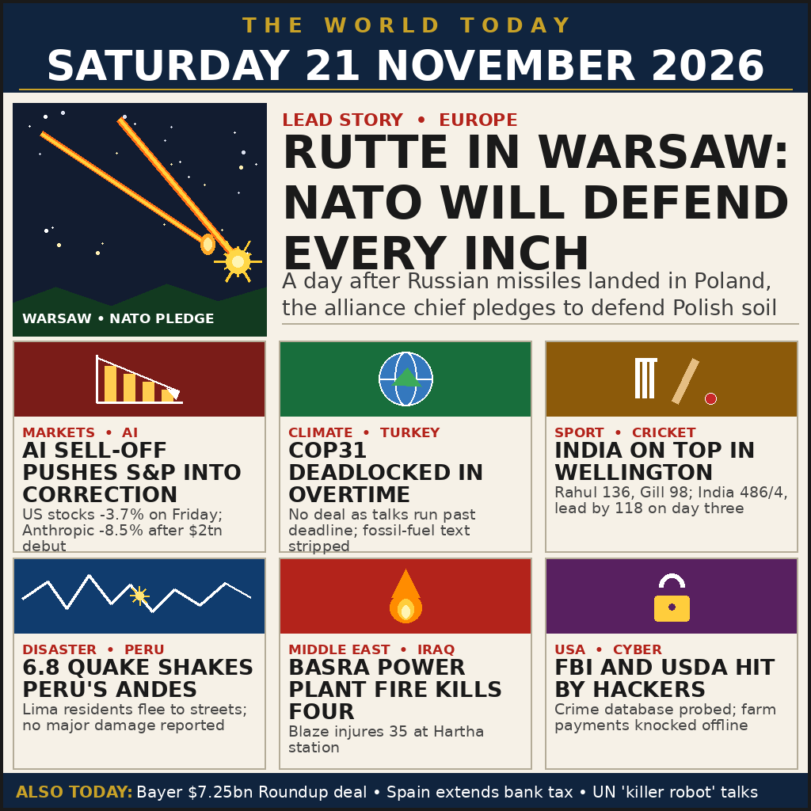

# news-image-20261121 — The World Today: Saturday 21 November 2026

[](https://make.fun/bounty/news-image-20261121)
[](https://make.fun/bounty/news-image-20261121)
[](https://make.fun/bounty/news-image-20261121)



A one-page newspaper front page summarising the world on Saturday
21 November 2026: NATO's pledge in Warsaw, the AI sell-off, COP31
overtime, India on top in Wellington, a 6.8 quake in Peru, the Basra
power plant fire, and the FBI/USDA hacks.

## Stories in the image

| Story | Source | Date |
| --- | --- | --- |
| Lead: Rutte in Warsaw — NATO will defend every inch | Reuters | 21 Nov 2026 |
| AI sell-off pushes S&P into correction | Reuters / NYT | 21 Nov 2026 |
| COP31 deadlocked in overtime | Reuters | 21 Nov 2026 |
| India on top in Wellington (day three) | ESPNcricinfo | 21 Nov 2026 |
| 6.8 quake shakes Peru's Andes | Reuters | 21 Nov 2026 |
| Basra power plant fire kills four | Reuters | 21 Nov 2026 |
| FBI and USDA hit by hackers | Reuters / CNN | 21 Nov 2026 |
| Also today: Bayer $7.25bn Roundup deal; Spain extends bank tax; UN "killer robot" talks | Reuters / AP | 21 Nov 2026 |

## How it is built

- `draw.py` renders the whole front page programmatically with Pillow
  and the system DejaVu fonts — every letter on the page is drawn by
  code, no AI-generated text or imagery.
- `main.ts` copies `entry.png` into the output directory
  (`$MAKEFUN_OUTPUT_DIR`, default `out`).

Build it:

```sh
python3 draw.py entry.png
MAKEFUN_OUTPUT_DIR=out node main.ts
```

Two runs of `main.ts` produce byte-identical `entry.png` files.
The PNG is 1024×1024 and under 1 MiB.

## License

MIT — see [LICENSE](LICENSE).
